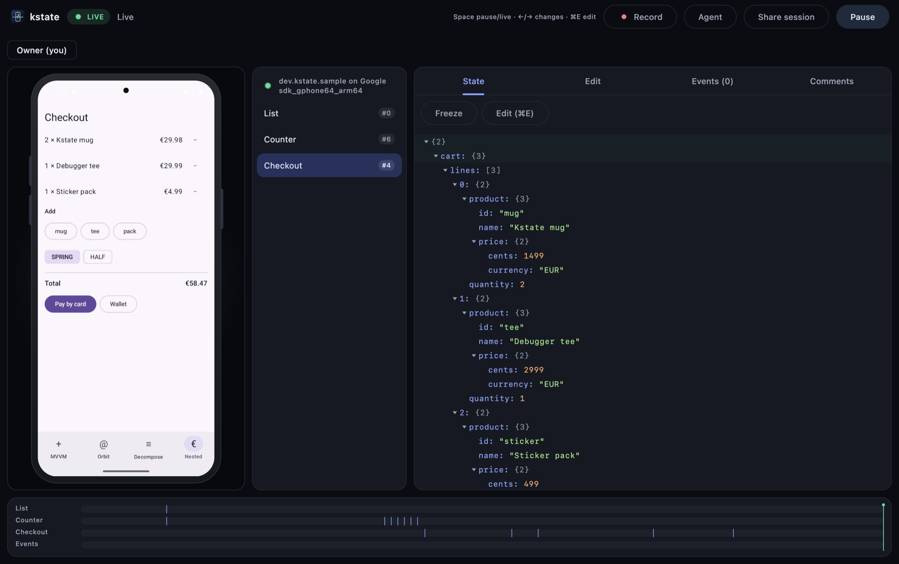
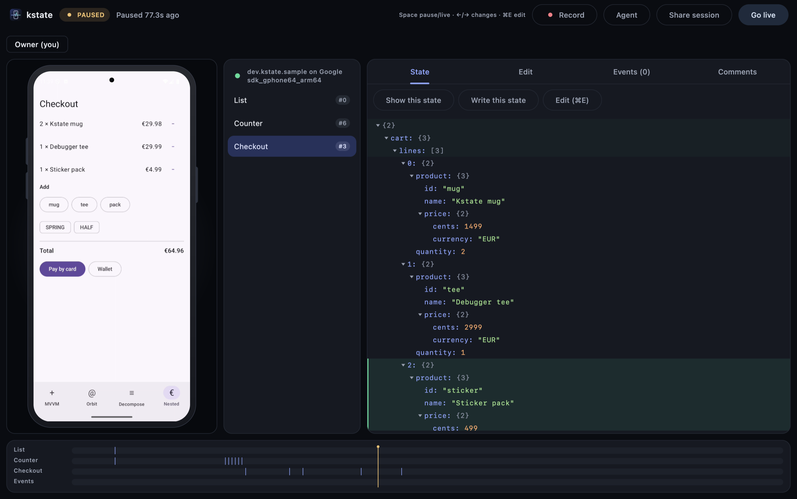
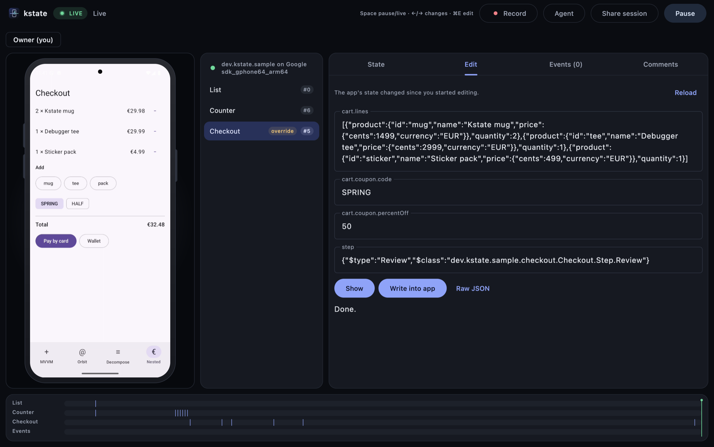
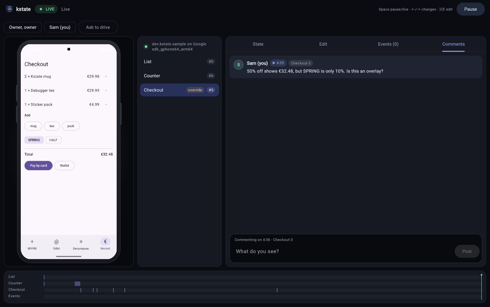
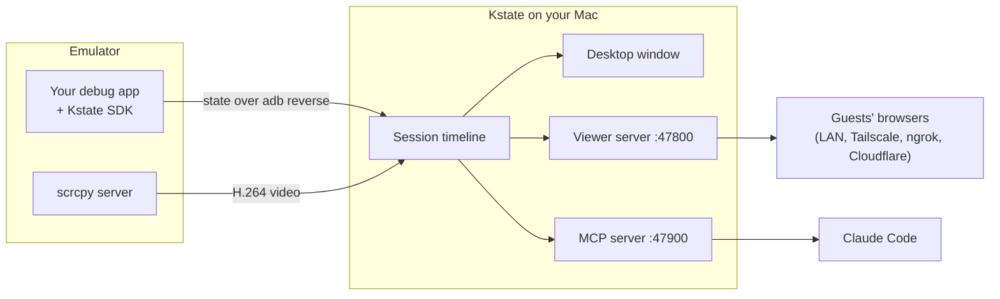

<h1 align="center">Kstate</h1>

<p align="center">
  <b>See your app's state next to its screen, on one timeline you can scrub.</b><br>
  Go back to an earlier state, edit the current one, record a session, share it in a browser,
  or let an agent test your screens by state.
</p>

<p align="center">
  
  
  
  
</p>



> **Status: early, not yet released.** Everything here runs from source today. There is no
> download and nothing on Maven Central yet, so the SDK is installed from your own machine (see
> [Add the SDK to your app](#add-the-sdk-to-your-app)). Android emulators only; iOS Simulator
> support is planned. See [docs/SPEC.md](docs/SPEC.md) for the design.

**Contents:** [Features](#features) · [Try it](#try-it-with-the-sample-app) ·
[Add the SDK](#add-the-sdk-to-your-app) · [How it works](#how-it-works) ·
[Privacy and security](#privacy-and-security) · [Build](#build)

## Features

### Live state next to the screen

Kstate is a macOS app that streams your Android emulator and, beside it, every piece of state your
app marks: a `StateFlow`, an Orbit container, an MVIKotlin store, a Decompose value, LiveData or an
Rx stream. Each state shows as a tree with what changed highlighted. The device stays fully usable:
click and type in the video as you would in the emulator.

### Scrub back in time

Every change lands on a timeline, one lane per state. Pause and drag the scrubber, or step from
change to change, and the picture and the state move together. On a past state of one you marked
with `inspectable()`:

- **Show this state** puts it on screen without touching your app's data (an overlay).
- **Write this state** puts it back for real, as if your code had set it.

Back on live, **Freeze** holds what is on screen while you poke at the UI, and **Release** gives
control back to your app. Changes made meanwhile are kept on the timeline as red ticks, so you can
see what was held back. Your app keeps up to the last 200 states of each one to go back to.



### Edit a state

For states marked with `inspectable()`, the **Edit** tab builds a form from the state's type: text,
numbers, switches and enums, with nested classes as their own fields, and lists, maps and sealed
values as JSON. Change a value, press **Show** or **Write into app**, and your app shows it, without
clicking through the app to reach the case you want: an empty list, a 40-character name, an error
state. Here the coupon goes from 10% to 50% off.



### Record and replay

Record a session (⌘R) and Kstate saves the video and every state together. Open it later, export
it as one `.kstate` file, and open it on another Mac to scrub through exactly what you saw. From a
recording you can push a recorded state into the same state of the app running now, after
confirming.

### Collaborative sessions in the browser

Share a session (⇧⌘S) and send the link. Guests open it in a browser, with nothing to install, and
get the same view: live video, every state, the timeline. Everyone sees who else is in the session
and who is driving, and anyone can leave a comment pinned to a moment.



- **Viewers** watch and comment. A viewer can **Ask to drive**, and you choose who drives the
  device: one guest at a time, alongside you.
- **You stay in charge.** Guests can't write states into the app; only you, or an agent you
  connected, can. A driver can show states only if you allow it.
  Every rule is checked on your Mac, not just hidden in the guest's page.
- **Reach guests how you like:** your LAN, Tailscale for your team, or ngrok or a Cloudflare
  quick tunnel for people outside. Kstate starts and stops the tunnel itself.
- **Links are private:** the invite token sits in the link's `#` part, so tunnels and proxies never
  log it. Invites last 8 hours and are revoked the moment you stop sharing.

### Agent testing

Turn on **Agent testing** (⇧⌘A) and connect Claude Code, or any MCP client. Instead of scanning
the UI, the agent works with your app's states directly: it sets a state, waits for the screen to
settle, and looks.

- **Look:** `overview`, `get_state`, `screenshot`, `map` (the screens it has seen and how they
  connect)
- **Act:** `set_state`, `release`, `tap`, `swipe`, `key`, `type_text`
- **Test:** for states marked with `inspectable()`, `explore` tries variants built from the state's
  type: every sealed case and enum
  value, null, empty and crowded lists, long, right-to-left and emoji text, zero, negative and huge
  numbers. `variant` looks at one closely, and `report` writes an HTML report where each finding
  points at the state that reproduces it.

Values you mark `@Sensitive` are never changed by the agent.

### Works with your architecture

Mark a `StateFlow` with one call, or add an adapter. Adapters only report state, so Kstate can
watch it; to go back, edit or explore, expose the state with `inspectable()`.

| Library | Artifact | Call |
| --- | --- | --- |
| `StateFlow` | `io.github.badranh:sdk-core` | `stateFlow.inspect(scope, "Name")` |
| Orbit | `io.github.badranh:adapter-orbit` | `inspect("Name")` inside a `ContainerHost` |
| MVIKotlin | `io.github.badranh:adapter-mvikotlin` | `store.inspect(scope, "Name")` |
| Decompose | `io.github.badranh:adapter-decompose` | `value.inspect(lifecycle, "Name")` |
| LiveData | `io.github.badranh:adapter-livedata` | `liveData.inspect(owner, "Name")` |
| RxJava 3 | `io.github.badranh:adapter-rx` | `observable.inspect(scope, "Name")` |

## Try it with the sample app

You need a Mac with Apple silicon, JDK 17 or newer, and the Android SDK with an emulator running
Android 8.0 (API 26) or newer.

1. Start an Android emulator.
2. Run Kstate:

   ```bash
   ./gradlew :app:desktop:run
   ```

3. Install the sample app, then open **Kstate Sample** on the emulator:

   ```bash
   ./gradlew :sample:androidApp:installDebug
   ```

The emulator shows up in Kstate with the sample's screen and its state. The sample has a counter,
a checkout flow, a sign-up form on Orbit and a list on Decompose. Tap **+1** and watch the state
change, then pause and scrub back.

## Add the SDK to your app

Until the SDK is on Maven Central, publish it to your machine's Maven repository (`~/.m2`) from a
clone of this repository (this builds the iOS libraries too, so it needs Xcode):

```bash
./gradlew publishToMavenLocal
```

Your app needs **Kotlin 2.3 or newer** (the SDK is built with Kotlin 2.4) and a minSdk of 26 or
higher. Take only Kstate from `mavenLocal()`:

```kotlin
// settings.gradle.kts
dependencyResolutionManagement {
    repositories {
        mavenLocal { content { includeGroup("io.github.badranh") } }
        google()
        mavenCentral()
    }
}
```

Add the SDK, and swap it for `sdk-noop` in release builds. `sdk-noop` has the same API and does
nothing, so your code, any adapters and any shared Kotlin Multiplatform module that calls Kstate
still build, with none of the SDK inside:

```kotlin
// app/build.gradle.kts
dependencies {
    implementation("io.github.badranh:sdk-core:0.1.0-SNAPSHOT")
}

// Every release classpath, flavored or not, gets sdk-noop instead of sdk-core.
val releaseClasspath = Regex("(^release|Release)\\w*(Runtime|Compile)Classpath$")
configurations.matching { releaseClasspath.containsMatchIn(it.name) }.configureEach {
    resolutionStrategy.dependencySubstitution {
        substitute(module("io.github.badranh:sdk-core")).using(module("io.github.badranh:sdk-noop:0.1.0-SNAPSHOT"))
    }
}
```

Add adapters next to `sdk-core`, with `implementation` too; the swap covers them. This
repository's sample does the same through a Gradle plugin (`dev.kstate.guard`) that also fails a
release build if `sdk-core` gets in. The plugin isn't published yet.

Start Kstate in `Application.onCreate`, before any screen is created: state marked before
`Kstate.start()` isn't tracked. Then mark the state you want to see:

```kotlin
Kstate.start()

// Read-only
val state = _state.asStateFlow().inspect(viewModelScope, "Payment")

// Or let Kstate put earlier or edited states back
val state = _state.inspectable(viewModelScope, "Payment", writeThrough = { _state.value = it })
```

Run the debug build on an emulator while Kstate is open, and your states appear. `Kstate.start()`
does nothing in a build that isn't debuggable.

### Connect an agent

Choose **File > Agent testing…** (⇧⌘A) in Kstate and turn it on. It shows the command that connects
Claude Code, with a token for this Mac only:

```bash
claude mcp add --transport http kstate http://127.0.0.1:47900/mcp --header "Authorization: Bearer <token>"
```

Agent access is off each time Kstate starts.

## How it works



- The SDK sends each state as JSON over a WebSocket that `adb reverse` carries to the Mac. An
  `inspectable()` state also sends its type's schema once, which is what the Edit form and the
  agent's variants are built from. Your app opens no port of its own.
- The video comes from [scrcpy](https://github.com/Genymobile/scrcpy)'s server, decoded with
  FFmpeg. Kstate stamps the video and every state with one clock, which keeps them in step when
  you scrub.
- The web viewer is the same Compose UI compiled to WebAssembly, served by the Mac, decoding the
  video with WebCodecs.

## Privacy and security

- **Local by default.** Everything binds to `127.0.0.1`. Nothing leaves your Mac until you share a
  session, and adb, scrcpy and your app's connection are never exposed even then.
- **Debug builds only.** `Kstate.start()` does nothing in a build that isn't debuggable, and
  release builds get `sdk-noop`, which holds no networking code at all.
- **Secrets stay hidden.** Fields marked `@Sensitive` are redacted before they leave the app, and
  can't be edited from Kstate or by an agent.
- **The agent needs a key.** The MCP server is off until you turn it on, takes connections from
  this Mac only, and checks a bearer token you can replace at any time.

## Build

```bash
./gradlew check apiCheck
```

`check` also runs the iOS tests, so it needs Xcode.

| What | Command |
| --- | --- |
| Desktop app | `./gradlew :app:desktop:run` |
| Unsigned DMG | `./gradlew :app:desktop:packageDmg` |
| Android sample | `./gradlew :sample:androidApp:installDebug` |
| Web viewer | `./gradlew :app:web:wasmJsBrowserDevelopmentRun` |
| SDK to `~/.m2` | `./gradlew publishToMavenLocal` |

See [CONTRIBUTING.md](CONTRIBUTING.md) before opening a pull request, and
[docs/DECISIONS.md](docs/DECISIONS.md) for why things are the way they are.

## License

Apache-2.0. See [LICENSE](LICENSE) and [NOTICE](NOTICE).
